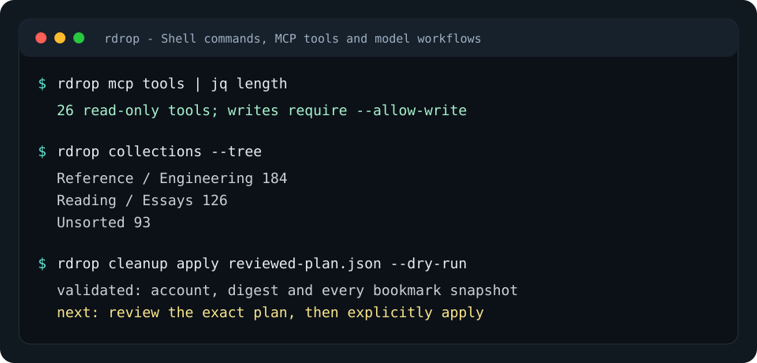

# raindrop-cli

[](https://github.com/KingPsychopath/raindrop-cli/actions/workflows/ci.yml)
[](https://github.com/KingPsychopath/raindrop-cli/actions/workflows/release.yml)
[](https://github.com/KingPsychopath/raindrop-cli/releases/latest)
[](https://www.npmjs.com/package/@machineyearn/raindrop-cli)
[](LICENSE)
[](https://goreportcard.com/report/github.com/KingPsychopath/raindrop-cli)

A Go CLI, local MCP server and model-driven organizer for Raindrop.io. Search and manage bookmarks from a shell, connect an existing agent, or run a tool-calling model directly. Keep your own tags and collection structure; export context, review proposals, then apply exact snapshot plans.

The CLI, MCP tools and direct model loop share the same Go command implementation. Optional decision providers include TypeSafe Jev, local Laya, compatible HTTP services and trusted local executables. No model is needed for ordinary commands.



## Install

Build the current source with the Go version declared in [go.mod](go.mod):

```sh
make install
rdrop version
```

Or install the native executable through Homebrew or the optional npm launcher:

```sh
brew install KingPsychopath/tap/rdrop
# Node 22+, with optional dependencies enabled:
npx --yes @machineyearn/raindrop-cli@0.2.0 version
npx --yes @machineyearn/raindrop-cli@0.2.0 mcp serve
```

[GitHub releases](https://github.com/KingPsychopath/raindrop-cli/releases) provide six native archives and the matching checksums. Or `make build` and use `./bin/rdrop`. See [packaging](docs/PACKAGING.md) for exact artifacts, npm, Homebrew and Docker.

## Configure

Create a test token in your [Raindrop integration settings](https://app.raindrop.io/settings/integrations), then store it in a private env file:

```text
RAINDROP_TOKEN=your_token_here
```

Use `$XDG_CONFIG_HOME/rdrop/env` or `~/.config/rdrop/env`, with directory permissions `700` and file permissions `600`. `RAINDROP_TOKEN` in the environment takes precedence. `RAINDROP_TOKEN_FILE` selects a plain token file; `RAINDROP_CONFIG_FILE` selects an env file. The legacy OpenClaw env path remains a fallback. Files are parsed as literals, never sourced as shell code.

```sh
rdrop config paths
rdrop config show        # redacted diagnostics
rdrop doctor
```

## Shell workflows

```sh
rdrop collections --tree
rdrop search 'type:article #go' --json | jq '.items[].link'
rdrop tags --json
rdrop export --format csv > bookmarks.csv
rdrop help collection
rdrop completion zsh > _rdrop
```

Lists use tab-separated rows by default. `--json` preserves metadata; exports, backups and cached copies write bytes to stdout. Pages are zero-based, with at most 50 items per page. Collection `0` reads all saved items except Trash, `-1` is Unsorted and `-99` is Trash. Bulk bookmark writes require an explicit source collection.

## Review and organize

Start with a report. Select exact bookmarks before planning changes:

```sh
rdrop cleanup report --json > cleanup-report.json
rdrop context --ids 101,102 > library-context.json
jq 'del(.snapshots)' library-context.json > model-context.json
```

The model view contains existing tag names and counts, collection paths and bookmark metadata. The original context also retains private snapshots for stale checks. Give any model or rule engine the model view and ask it for the [proposal format](docs/ORGANIZING.md#provider-neutral-proposals).

```sh
rdrop organize plan --context library-context.json --proposal proposal.json > organization.json
jq '.plan // error("No accepted changes")' organization.json > reviewed-plan.json
# Inspect organization.json, including needsReview and unmentioned entries.
rdrop cleanup apply reviewed-plan.json --dry-run
rdrop cleanup apply reviewed-plan.json --yes
```

Plans append tags without dropping existing names and can combine tags and a move in one bookmark update. Unknown IDs, tags and destinations fail validation. New tags need explicit policy rules. Account, digest and every selected bookmark are checked before the first write. Raindrop has no transaction here: concurrent edits and partial failures require inspection and a fresh plan. [Organizing guide](docs/ORGANIZING.md).

For a manual bulk plan:

```sh
rdrop cleanup plan --action tag --collection=-1 --ids 101,102 --tags reference > reviewed-plan.json
```

## Connect an agent through MCP

```sh
rdrop connect mcp                 # print client configuration
rdrop mcp serve                   # stdio; read-only
rdrop mcp tools                   # offline JSON tool catalog
rdrop connect acp --cwd "$PWD"    # session/new params for an existing ACP agent
```

Configure the generated command in your MCP client. Tokens stay in the environment or private config file. The server includes an organizing prompt, guide resource, structured tools and bounded context/proposal planning. Add `--allow-write` only when the host is authorized to expose mutations. `confirm:true` expresses caller intent; the host must enforce human review where required.

ACP support means supplying this MCP server to an existing ACP agent. `rdrop` does not implement an ACP agent server. HTTP configurations for Raindrop's official MCP and Executor are available through `connect raindrop` and `connect executor`. The [Executor adapter](integrations/executor) provides portable REST tools and exact-call approval for its writes. [Integration guide](docs/INTEGRATIONS.md).

## Run a model directly

```sh
# Set RDROP_MODEL_API_KEY in your secret environment first.
rdrop agent --model your-tool-capable-model --json \
  'Review the first page of untagged bookmarks. Use existing tags and propose a plan.' > agent-result.json
jq '.plans[0] // error("No plan generated")' agent-result.json > reviewed-plan.json
```

This is a complete request → tool call → tool result → model response loop. It starts with the cleanup report and a bounded context, executes validated tools, returns results to the model, and stops at configured step, call and time limits. Read-only is the default; actual tool results and exact generated plans are captured separately from model prose. Explicit `--allow-write` authorizes model-selected mutations.

Responses API is the default. For a compatible local or hosted Chat Completions server:

```sh
rdrop agent --base-url http://127.0.0.1:1234/v1 --api chat --model local-model \
  'Inspect my existing tags and propose organization.' --json
```

The model must actually support tool calls. Local loopback endpoints can run without an API key. [Model configuration and limits](docs/MODELS.md).

## Optional typed decisions

```sh
# taxonomy.json: {"reference":"Technical documentation", "read-later":"Long-form reading"}
rdrop classify --ids 101,102 --taxonomy taxonomy.json --json

# Local laya-serve: separately install and start the upstream service.
RDROP_DECISION_BASE_URL=http://127.0.0.1:8000/v1 \
RDROP_DECISION_MODEL=english \
rdrop classify --ids 101,102 --taxonomy taxonomy.json --json
```

Default HTTP provider: TypeSafe Jev, configured with `TYPESAFE_API_KEY`. Local commands use the same typed decision contract. Classification validates chosen labels and distributions and marks low-confidence or abstained results for review; it does not apply tags. Provider confidence scores need evaluation on your own taxonomy. Multi-tag and move proposals use the provider-neutral context contract above. [Jev, Laya and command adapters](docs/MODELS.md#typed-decision-providers).

## Reference and development

- [All commands and flags](docs/COMMANDS.md), generated by `rdrop help --markdown`.
- [REST and MCP coverage](docs/API_COVERAGE.md).
- [Real local model and Executor verification](docs/VERIFICATION.md).
- [Contributing](CONTRIBUTING.md), [security boundaries](SECURITY.md), [roadmap](docs/ROADMAP.md), [changelog](CHANGELOG.md).

```sh
make check             # formatting, modules, vet, focused/full tests, build, docs parity
make check-integrations # npm launcher, Executor framework and Laya adapter contracts
```

MCP uses the official Go SDK. The REST client, model clients and planning code use the standard library. CI verifies fixture contracts. [Live verification](docs/VERIFICATION.md) records the real local model loop, Laya classification and Executor account checks, with commands to repeat them.
