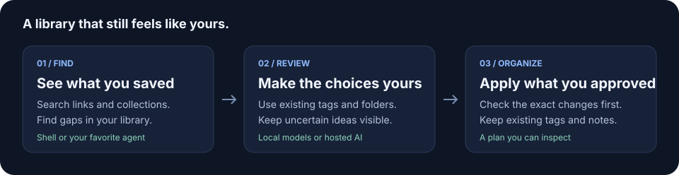

# raindrop-cli

**Find, review and organize your saved links. Keep your tags. Bring your own AI.**

[](https://github.com/KingPsychopath/raindrop-cli/actions/workflows/ci.yml)
[](https://github.com/KingPsychopath/raindrop-cli/actions/workflows/release.yml)
[](https://github.com/KingPsychopath/raindrop-cli/releases/latest)
[](https://www.npmjs.com/package/@machineyearn/raindrop-cli)
[](LICENSE)
[](https://goreportcard.com/report/github.com/KingPsychopath/raindrop-cli)

Turn a growing [Raindrop.io](https://raindrop.io) library into something easier to use. Search saved links, inspect collections, find cleanup opportunities and review suggestions before making changes. Use it from your terminal or let your favorite agent do the reading and planning.

- **Your organization stays yours.** Start with the tags and collections you already created; preserve existing tags when applying a plan.
- **Changes you can inspect.** See exact bookmarks, proposed tags and destinations, then dry-run the plan before applying it.
- **AI that fits your workflow.** Connect Codex or Claude, use a hosted tool-capable model, or run local Qwen and Laya.
- **A useful CLI without AI.** Search, edit, export, manage highlights and collections, and build shell pipelines.


## Get started

v0.2.0 is available through Homebrew and [native downloads](https://github.com/KingPsychopath/raindrop-cli/releases/tag/v0.2.0). Its npm tarballs are built and verified; registry publication awaits the owner's required npm 2FA setup. Use Homebrew or native binaries meanwhile. [Publishing status and commands](docs/PACKAGING.md#npm-packages).

Install:

```sh
brew install KingPsychopath/tap/rdrop
# After npm registry publication: Node 22+, optional dependencies enabled:
npm install --global @machineyearn/raindrop-cli@0.2.0
rdrop version
```

Prefer no global npm install? Use `npx --yes @machineyearn/raindrop-cli@0.2.0 COMMAND`. [Native downloads and checksums](https://github.com/KingPsychopath/raindrop-cli/releases/latest) are available for macOS, Linux and Windows on Intel/AMD and ARM. You can also build with `make install`; [packaging details](docs/PACKAGING.md).

Create a token in your [Raindrop integration settings](https://app.raindrop.io/settings/integrations). Put this line in `~/.config/rdrop/env`, with directory permissions `700` and file permissions `600`:

```text
RAINDROP_TOKEN=your_token_here
```

Then try:

```sh
rdrop doctor
rdrop collections --tree
rdrop search 'type:article #go' --json
rdrop cleanup report --json
```

Environment variables take precedence. Custom token/config paths and redacted diagnostics are documented in [configuration](docs/COMMANDS.md#config). Keep tokens in private configuration, outside chat and Git.

## Choose your workflow

| You want to… | Start here |
| --- | --- |
| Find links, manage collections or export your library | [Shell commands](docs/COMMANDS.md) |
| Use Codex, Claude or another MCP client | [Client setup and plugins](docs/CLIENTS.md) |
| Ask a model to inspect your library and propose changes | [Run a model directly](docs/MODELS.md) |
| Use Raindrop's semantic search and AI-assisted reads | [Official MCP tools](docs/OFFICIAL_MCP.md) |
| Classify selected bookmarks with Jev, Laya or Clef | [Decision providers](docs/MODELS.md#typed-decision-providers) |
| Run portable Raindrop tools in Executor | [Executor setup](docs/INTEGRATIONS.md#executor) |

## Organize with a plan



Begin with a report and select the exact bookmarks you want to review:

```sh
rdrop cleanup report --json > cleanup-report.json
rdrop context --ids 101,102 > library-context.json
jq 'del(.snapshots)' library-context.json > model-context.json
```

The model view contains your existing tag names, collection paths and bookmark metadata. Keep the original context private: its snapshots are used to detect edits before applying. Ask any model or rule engine for the [proposal format](docs/ORGANIZING.md#provider-neutral-proposals), then validate it:

```sh
rdrop organize plan --context library-context.json --proposal proposal.json > organization.json
jq '.plan // error("No accepted changes")' organization.json > reviewed-plan.json
# Review accepted changes, needsReview and unmentioned items.
rdrop cleanup apply reviewed-plan.json --dry-run
rdrop cleanup apply reviewed-plan.json --yes
```

Plans keep existing tags and can combine new tags with a collection move. Unknown names and destinations fail validation; new tags need explicit naming rules. Account, digest and snapshots are checked before writing. Concurrent edits or partial failures need inspection and a fresh plan. [Organizing and recovery](docs/ORGANIZING.md).

## Use your agent

The [Codex and Claude plugin](integrations/agent-plugin) bundles a shared organizing skill and a read-only MCP connection. [Install instructions](docs/CLIENTS.md) also cover direct setup for other local clients.

```sh
rdrop connect mcp                         # client configuration, without tokens
rdrop mcp serve                           # read-only tools over stdio
rdrop mcp tools --search 'organize tags'   # discover relevant schemas offline
rdrop mcp tools --name raindrop_context    # inspect one exact schema
rdrop mcp serve --official                # also include Raindrop's hosted AI reads
```

Default tools read and plan. Enable writes only for an authorized host that enforces review. The official extension imports documented read tools; its plan limits and service availability still apply. [Coverage and comparison with the official server](docs/OFFICIAL_MCP.md).

You can also run a model directly:

```sh
# With your model API key in a private environment:
rdrop agent --model your-tool-capable-model --json \
  'Review the first page of untagged bookmarks. Use existing tags and propose a plan.' > agent-result.json
```

The model receives actual tool results and returns a response plus exact generated plans. Step, call and time limits bound the run. Local Chat Completions servers and hosted Responses APIs are supported. Jev, Laya and Cloudflare Clef provide typed category decisions; uncertainty stays visible. [Model setup and exact commands](docs/MODELS.md).

## Verified and maintained

A real Qwen/Laya loop classified bookmarks, generated a plan and applied it to a disposable test library while preserving existing tags and notes. The local Executor deployment passed connected-account health and live read checks. [Repeat the verification](docs/VERIFICATION.md), including its limits: this smoke check is not an accuracy benchmark, and Jev/Clef live inference requires provider credentials.

The product focuses on Raindrop. Model providers and proposal formats are agnostic; Obsidian and other note sources remain [future options](docs/ROADMAP.md).

## For developers

A native Go CLI, local MCP server and direct model loop share the command implementation. The REST client, model clients and planning code use the standard library; MCP uses the official Go SDK. ACP configuration supplies this server to an existing ACP agent. Executor offers a smaller portable REST adapter. Docker is available as a packaging option.

- [Command reference](docs/COMMANDS.md) · [API coverage](docs/API_COVERAGE.md) · [Integrations](docs/INTEGRATIONS.md)
- [Contributing](CONTRIBUTING.md) · [Security](SECURITY.md) · [Changelog](CHANGELOG.md)

```sh
make check               # Go checks, build and generated-doc parity
make check-integrations  # npm, Executor and Laya contracts
make assets              # regenerate the terminal graphic
```
